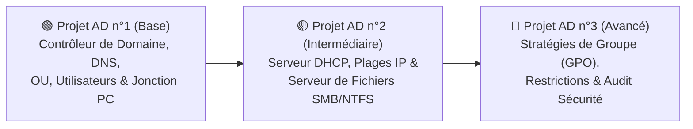
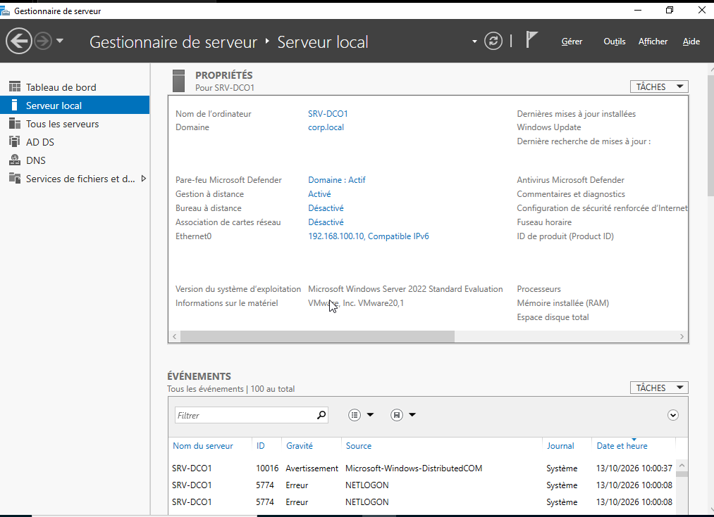
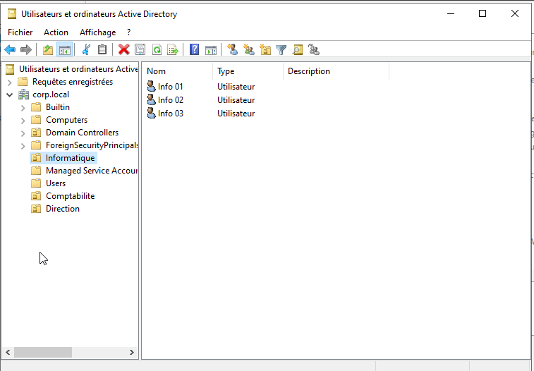
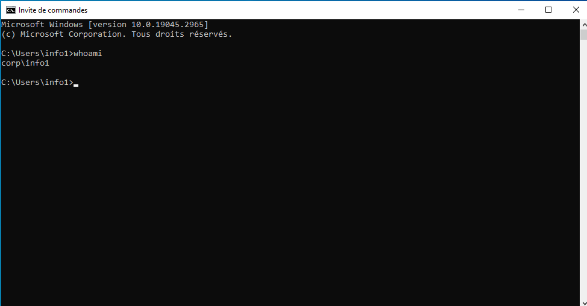
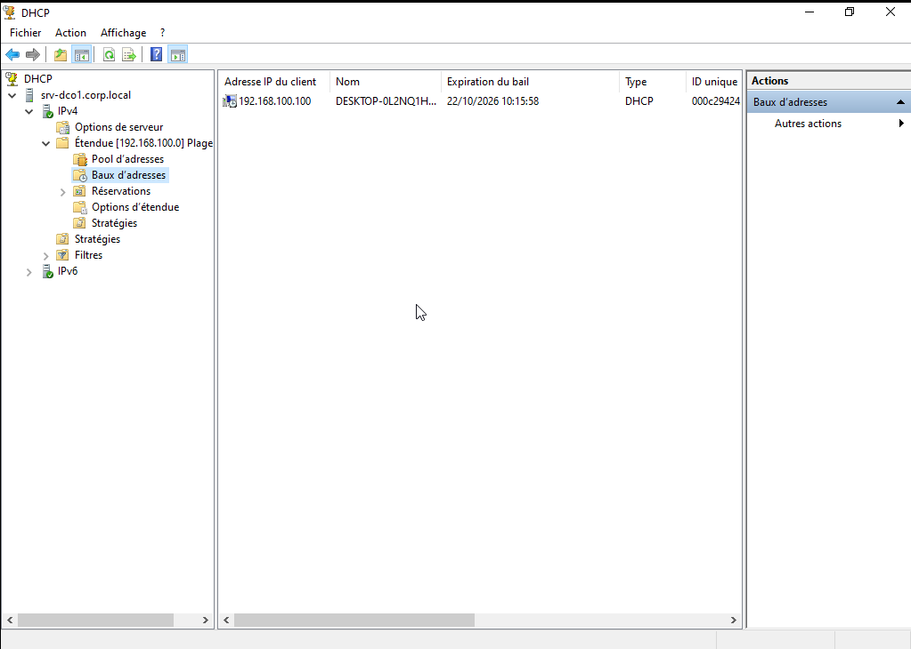
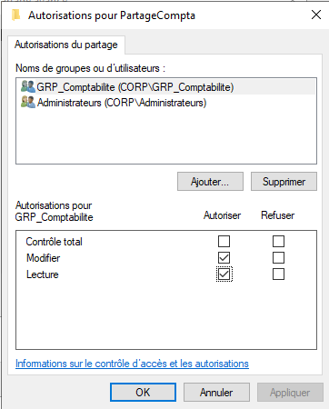
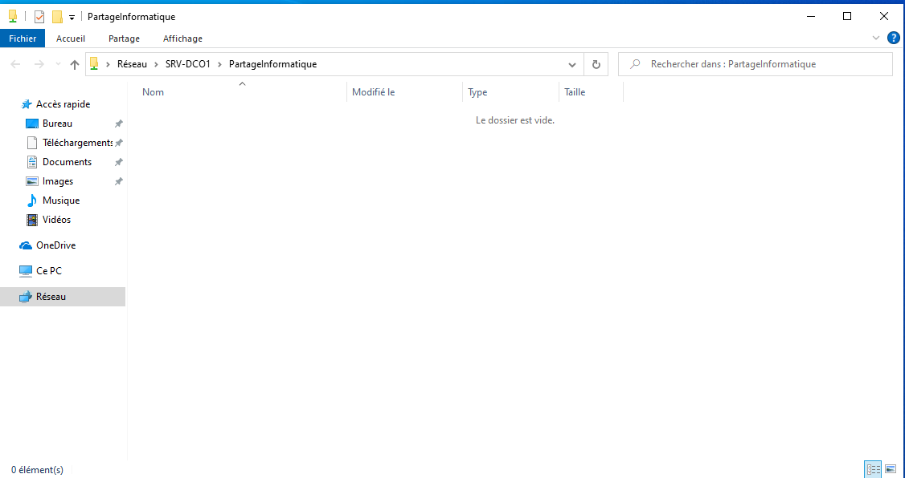

# 🏢 Windows & Linux Enterprise SysAdmin Infrastructure


> **Parcours complet et progressif d'Administration Systèmes & Réseaux : maîtrise pas-à-pas de Windows Server (Active Directory) par projets de difficulté croissante, suivie de l'administration et de la sécurisation sous Linux Ubuntu Server.**

---

## 🎯 Approche du Dépôt (Progression par Niveau)

Ce dépôt regroupe mes travaux pratiques d'administration système organisés **par ordre croissant de complexité** :
1. **Volet 1 — Windows Server & Active Directory** *(Du déploiement initial jusqu'aux stratégies GPO avancées et l'audit de sécurité)*.
2. **Volet 2 — Linux Ubuntu Server** *(De l'administration système en ligne de commande jusqu'à l'hébergement de services et au durcissement SecOps)*.

---

## 🟦 VOLET 1 : Projets Windows Server & Active Directory (Ordre Croissant)



### 🟢 Projet AD n°1 — Niveau Base : Déploiement du Domaine & Identités
**Objectif :** Monter un premier contrôleur de domaine d'entreprise fonctionnel et y connecter un poste client.
- Configuration réseau statique (`192.168.100.10/24`) et renommage du serveur (`SRV-DC01`).
- Installation des rôles **AD DS (Active Directory Domain Services)** et **DNS**.
- Promotion du serveur et création de la forêt **`corp.local`**.
- Structuration de l'annuaire : création des **Unités d'Organisation (OU)** (`Direction`, `Informatique`, `Comptabilite`, `Postes-Clients`), des groupes et des utilisateurs.
- Jonction d'un poste client **Windows 10/11 Pro (`PC-CLIENT01`)** au domaine et ouverture de session employé.

📄 **Documentation détaillée :** [`docs/01-Active-Directory-Setup.md`](./docs/01-Active-Directory-Setup.md)

| Gestionnaire de Serveur (`SRV-DC01`) | Arborescence Active Directory (OU & Users) | Poste Windows 10/11 joint au domaine |
| :---: | :---: | :---: |
|  |  |  |

---

### 🟡 Projet AD n°2 — Niveau Intermédiaire : Réseau DHCP & Serveur de Fichiers (SMB/NTFS)
**Objectif :** Automatiser l'attribution réseau des postes clients et cloisonner les fichiers de l'entreprise par service.
- Installation et autorisation du rôle **Serveur DHCP** dans Active Directory.
- Création d'une étendue IPv4 (`192.168.100.100` à `.200`) distribuant automatiquement la passerelle, le serveur DNS (`192.168.100.10`) et le suffixe `corp.local`.
- Mise en place d'un **Serveur de Fichiers SMB** (`\\SRV-DC01\Partages`) avec gestion granulaire des droits **NTFS** :
  - Dossier `Direction` réservé au groupe `GRP_Direction`.
  - Dossier `Comptabilite` réservé au groupe `GRP_Comptabilite`.

| Configuration DHCP & Baux actifs | Permissions du Partage SMB (Serveur) | Accès au Partage depuis le PC Client |
| :---: | :---: | :---: |
|  |  |  |

---

### 🔴 Projet AD n°3 — Niveau Avancé : Stratégies de Groupe (GPO) & Sécurité Active Directory
**Objectif :** Administrer et sécuriser à distance tous les postes et comptes de l'entreprise via des stratégies centralisées.
- **GPO Sécurité des Comptes** : Politique de mots de passe renforcée (12 caractères min., complexité activée) et verrouillage automatique après 3 tentatives (anti-bruteforce).
- **GPO Durcissement des Postes Clients** :
  - Blocage du Panneau de configuration et des Paramètres Windows pour les utilisateurs standards.
  - Activation forcée du Pare-feu Windows Defender sur le profil Domaine.
- **Audit de sécurité automatisé** : Vérification de la conformité du Contrôleur de Domaine via le script [`scripts/audit-ad-security.ps1`](./scripts/audit-ad-security.ps1) (contrôle SMBv1, comptes à privilèges, règles de pare-feu).

| Console des Stratégies de Groupe (GPO) |
| :---: |
|  |

---

## 🟧 VOLET 2 : Projets Linux Ubuntu Server (Ordre Croissant)

> *Ce second volet intervient après la maîtrise complète de l'environnement Windows Server / Active Directory.*

1. **🟢 Projet Linux n°1 (Base)** : Installation d'Ubuntu Server 24.04 LTS, configuration réseau statique (`Netplan`), gestion des comptes/droits `sudo` et administration à distance via **SSH**.
2. **🟡 Projet Linux n°2 (Intermédiaire)** : Déploiement d'un serveur Web Intranet (**Nginx**) et intégration DNS au réseau d'entreprise (`intranet.corp.local`).
3. **🔴 Projet Linux n°3 (Avancé — Hardening)** : Sécurisation du serveur via pare-feu **UFW**, protection anti-intrusion **Fail2ban**, durcissement SSH (`PermitRootLogin no`) et automatisation via [`scripts/harden-ubuntu.sh`](./scripts/harden-ubuntu.sh).

📄 **Documentation détaillée :** [`docs/02-Ubuntu-Server-Setup.md`](./docs/02-Ubuntu-Server-Setup.md)

| Sécurisation Ubuntu Server (UFW & Fail2ban) | Portail Intranet sur le réseau d'entreprise |
| :---: | :---: |
|  |  |

---

## 📂 Structure du Dépôt

```text
Windows-Linux-SysAdmin-Infrastructure/
├── README.md                          # Présentation progressive des projets (AD Niveau 1→3, puis Ubuntu 1→3)
├── docs/
│   ├── 01-Active-Directory-Setup.md   # Guide complet des 3 projets progressifs Windows Server / AD
│   ├── 02-Ubuntu-Server-Setup.md      # Guide complet des 3 projets progressifs Ubuntu Server
│   └── screenshots/                   # Captures d'écran classées dans l'ordre des projets
└── scripts/
    ├── audit-ad-security.ps1          # Script d'audit de sécurité Active Directory (Projet AD n°3)
    └── harden-ubuntu.sh               # Script de durcissement Ubuntu Server (Projet Linux n°3)
```

---

## 👤 Auteur

**dosantossasse-hue** — *Administrateur Systèmes & Réseaux | Pentest & Cybersécurité Automatisée*
